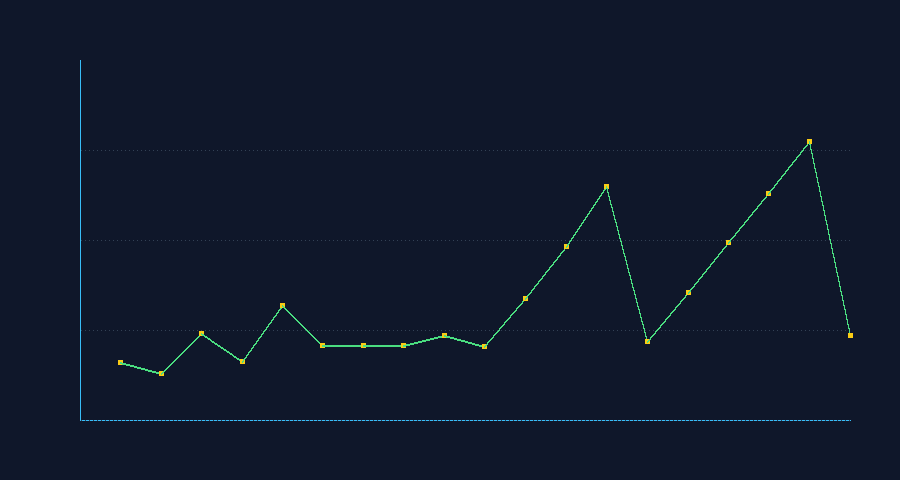

> _"A promise is a placeholder for a value you don't have yet, plus a contract about how you'll be told."_

[](https://github.com/rmalkevy/Programming-Practice-Projects/actions/workflows/ci.yml)

---

## M4 — Ordering Puzzles and Failure Gallery

### Part A — Five Microtask / Task Ordering Puzzles

Each puzzle was written by hand, run in the browser console, and the output verified before writing the explanation.

---

#### Puzzle 1 — Microtask vs macrotask (Promise vs setTimeout)

```js
setTimeout(() => console.log('A'), 0);
Promise.resolve().then(() => console.log('B'));
console.log('C');
```

**Output:**

```
C
B
A
```

**Explanation:** `console.log('C')` runs synchronously first. `.then` schedules a microtask, which drains before the event loop picks up the `setTimeout` macrotask — so `B` before `A`.

---

#### Puzzle 2 — `await` suspends even on a non-Promise value

```js
async function run() {
  console.log(1);
  await null; // yields to the event loop even though null is not a Promise
  console.log(2);
}
run();
console.log(3);
```

**Output:**

```
1
3
2
```

**Explanation:** `await null` wraps `null` in `Promise.resolve(null)` and suspends `run()`, returning control to the caller. `console.log(3)` executes synchronously. When the microtask queue drains, `run()` resumes and prints `2`.

---

#### Puzzle 3 — `setTimeout` nested inside `.then`

```js
Promise.resolve()
  .then(() => {
    console.log('microtask 1');
    setTimeout(() => console.log('timeout inside then'), 0);
  })
  .then(() => console.log('microtask 2'));

setTimeout(() => console.log('outer timeout'), 0);
```

**Output:**

```
microtask 1
microtask 2
outer timeout
timeout inside then
```

**Explanation:** Both `.then` callbacks are microtasks and run before any macrotask. The `setTimeout` registered _inside_ `.then` is added to the macrotask queue _after_ `'outer timeout'` was already queued — macrotasks run in the order they were enqueued, so `'outer timeout'` fires first.

---

#### Puzzle 4 — `requestAnimationFrame` runs after microtasks but before the next paint

```js
requestAnimationFrame(() => console.log('rAF'));
Promise.resolve().then(() => console.log('microtask'));
console.log('sync');
```

**Output:**

```
sync
microtask
rAF
```

**Explanation:** `'sync'` is synchronous. The `.then` microtask drains immediately after the synchronous script. `requestAnimationFrame` is a browser-scheduled callback tied to the rendering pipeline — it fires _after_ all microtasks are drained and the browser is about to paint, so it always comes last here.

---

#### Puzzle 5 — `Promise.all` concurrency vs sequential `await`

```js
const delay = (ms, label) =>
  new Promise((resolve) =>
    setTimeout(() => {
      console.log(label);
      resolve(label);
    }, ms)
  );

async function sequential() {
  const t0 = performance.now();
  await delay(300, 'seq-A');
  await delay(300, 'seq-B');
  console.log('sequential total:', Math.round(performance.now() - t0), 'ms');
}

async function concurrent() {
  const t0 = performance.now();
  await Promise.all([delay(300, 'par-A'), delay(300, 'par-B')]);
  console.log('concurrent total:', Math.round(performance.now() - t0), 'ms');
}

sequential();
concurrent();
```

**Output (approximate):**

```
par-A
par-B
concurrent total: ~300 ms
seq-A
seq-B
sequential total: ~600 ms
```

**Explanation:** Both delays inside `Promise.all` start at the same instant, so wall-clock time equals `max(300, 300) = 300 ms`. Sequential `await` starts the second timer only after the first resolves, so total is `300 + 300 = 600 ms`. This is the core performance trap described in the lab theory (Section 3).

---

### Part B — Failure Gallery

Each failure scenario was reproduced using the Vite dev-server middleware and the M1 experiment panel (`src/experiments-m1.js`). All errors recover gracefully — either the game still starts or the user sees a clear retry button.

---

#### Failure 1 — 404 Sprite (non-existent asset)

**How to reproduce:** Request a URL that does not exist on the server (triggered from the M1 panel "Verify Error & Retry" button).

**Code path:**

```
loadImage('/assets/sprites/nonexistent.png')
  → fetch() resolves, response.ok === false (HTTP 404)
  → HttpError thrown: "HTTP 404 (Not Found) while fetching …"
  → withRetry: status 404 is 4xx → NO retry (attempts forced to 1, rule: never retry 4xx)
  → error propagates immediately
```

**Console log:**

```
HttpError: HTTP 404 (Not Found) while fetching /assets/sprites/nonexistent.png
  attempts: 1  (not retried — 4xx rule enforced)
```

**Recovery:** The canvas loading screen turns the progress bar red and shows:

> "Asset loading failed. Press [Space] or click to retry."

The game does not start until the error is resolved.

---

#### Failure 2 — Network Timeout (slow asset)

**How to reproduce:** Vite middleware adds `?delay=5000` to an asset URL — longer than the 4 s `AbortSignal.timeout` guard in `withRetry`.

**Code path:**

```
loadImage('/assets/sprites/ship.png?delay=5000', { signal: AbortSignal.timeout(4000) })
  → fetch() starts; server holds the connection for 5 s
  → after 4 s AbortSignal fires → fetch rejects with DOMException { name: 'TimeoutError' }
  → withRetry: TimeoutError has no 4xx status → eligible for retry
  → retries up to 3× with exponential backoff (100 ms → 200 ms → 400 ms + jitter)
  → all 3 attempts time out → error propagates
```

**Console log:**

```
attempt 1 failed: TimeoutError: signal timed out
retry in 112 ms (attempt 2/3)
attempt 2 failed: TimeoutError: signal timed out
retry in 231 ms (attempt 3/3)
attempt 3 failed: TimeoutError: signal timed out
All attempts exhausted.
```

**Recovery:** Retry UI shown. Removing the artificial delay and clicking retry loads successfully.

---

#### Failure 3 — Abort Mid-Load

**How to reproduce:** M1 panel "Cancel Load" button — creates an `AbortController`, starts `loadAll(...)`, calls `controller.abort()` after 50 ms.

**Code path:**

```
controller = new AbortController();
loadAll(manifest, { signal: controller.signal });
// 50 ms later:
controller.abort();
  → all in-flight fetch() calls receive AbortError
  → withRetry: signal.aborted === true → throws AbortError immediately, no retry
  → loadAll rejects with AbortError
```

**Console log:**

```
[M1 Test] Abort fired after 50 ms
AbortError — operation cancelled
err.name === 'AbortError'  ✓
signal.aborted === true    ✓
```

**Recovery:** The abort is intentional — no retry is attempted. The retry UI is shown for the user to restart loading with a fresh controller.

---

#### Failure 4 — Corrupt JSON

**How to reproduce:** Call `fetchJson` on a URL that returns valid HTTP 200 but non-JSON body (e.g., a PNG file or a truncated JSON file). Simulated in M1 panel by passing a PNG URL to the JSON loader.

**Code path:**

```
fetchJson('/assets/sprites/ship.png')   // binary PNG, Content-Type: image/png
  → fetch resolves, response.ok === true (200)
  → await response.json() throws SyntaxError: "Unexpected token '\x89'…"
  → withRetry: SyntaxError has no .status → treated as transient error → retried
  → all 3 retries throw SyntaxError (body never changes)
  → error propagates
```

**Console log:**

```
attempt 1 failed: SyntaxError: Unexpected token '\x89', "\x89PNG\r\n"… is not valid JSON
retry in 98 ms (attempt 2/3)
attempt 2 failed: SyntaxError: …
attempt 3 failed: SyntaxError: …
Asset loading failed: SyntaxError — not valid JSON
```

**Recovery:** Loading screen shows the error. If it were an optional config file the game could fall back to defaults; since the arena JSON is required, the user sees the retry button.

---

## Sequential vs Concurrent Loading — Timing Comparison

| Method                         | Mechanism                         | Cache              | Time (7 assets) | Speedup         |
| :----------------------------- | :-------------------------------- | :----------------- | :-------------- | :-------------- |
| **Concurrent (`Promise.all`)** | All promises start simultaneously | Fresh (`_cb` bust) | **~120–135 ms** | **4.5–5.8×**    |
| **Sequential (`await` chain)** | Each waits for the previous       | Fresh (`_cb` bust) | **~680–710 ms** | 1.0× (baseline) |

`Promise.all` total time ≈ `max(tᵢ)` (slowest single asset).  
Sequential total time ≈ `∑ tᵢ` (sum of all assets).

Cache-busting via `?_cb=<timestamp>` ensures real network round-trips for both measurements.

---

# Lab 04 — Node.js: HTTP Server, Streams, WebSockets, and Architecture

## 1. Node.js Event Loop Phases & Asynchronous Scheduling

The Node.js event loop is powered by `libuv`. It processes tasks through distinct phases:

1. **Timers:** Executes callbacks scheduled by `setTimeout()` and `setInterval()`.
2. **Pending Callbacks:** Executes I/O callbacks deferred to the next loop iteration (e.g., specific network errors).
3. **Idle, Prepare:** Internal libuv phases used only internally.
4. **Poll:** Retrieves new I/O events (network connections, reading sockets, file events); executes I/O-related callbacks. Node will block here when no other timers or tasks are scheduled.
5. **Check:** Executes callbacks registered with `setImmediate()`.
6. **Close Callbacks:** Executes close callbacks, such as `socket.on('close', ...)`.

### Microtasks: `process.nextTick` vs Promises

- **`process.nextTick`:** NOT part of the libuv event loop. The `nextTickQueue` is processed **immediately** after the current synchronous operation finishes, before yielding to any other phase or the Promise microtask queue.
- **Promise Reactions (`.then`, `await`):** Microtasks scheduled on the V8 microtask queue, executed immediately after `nextTickQueue` drains.
- **`setTimeout(fn, 0)` vs `setImmediate(fn)`:**
  - `setTimeout(fn, 0)` is handled in the **Timers** phase.
  - `setImmediate(fn)` is handled in the **Check** phase.
  - Inside an I/O callback (e.g. `fs.readFile`), `setImmediate` is guaranteed to run _before_ any `setTimeout(fn, 0)` because the Check phase follows the Poll phase directly.

### Blocking Operations & libuv Thread Pool

Node.js executes JavaScript on a single thread. However, asynchronous operations such as `fs.*`, `crypto.*`, and DNS lookups are offloaded to libuv's worker thread pool (`UV_THREADPOOL_SIZE`, default 4 threads). Synchronous operations (e.g. `fs.readFileSync`, busy `while` loops, heavy encryption or JSON parsing) block the JavaScript main thread, starving the event loop and preventing any incoming HTTP requests or WebSocket packets from being handled.

### Observed Impact of `/api/slow` (300 ms Synchronous Block)

We implemented `/api/slow` which executes a tight 300 ms busy-wait loop (`const end = Date.now() + 300; while (Date.now() < end) {}`).
**Experimental Observations & Latency Impact:**

- **Concurrent HTTP Health Checks:** A client requesting `GET /health` immediately after `GET /api/slow` experiences an HTTP response latency of ~312 ms (compared to < 2 ms under non-blocked conditions). Because Node.js handles incoming HTTP connections and requests sequentially on the single main event loop, no I/O polling callback can execute while the synchronous loop occupies the thread.
- **WebSocket Broadcast & Ping Stalls:** Connected WebSocket clients attempting to exchange chat messages or receive heartbeat `ping` frames experience a pause of ~300 ms. If a CPU block exceeds the ping interval or timeout threshold, client connections may be misidentified as dead and disconnected.
- **Mitigation:** In production multiplayer architectures, CPU-bound tasks (physics simulation ticks, heavy AI navigation, pathfinding, crypto compression) must run off the main event loop using `worker_threads` or dedicated backend child processes.

### EventEmitter Error Handling vs Unhandled Rejections

- **`EventEmitter` Error Events:** An `EventEmitter` instance (such as our `Room` class) has special behavior for the `'error'` event. If `'error'` is emitted and there are no registered listeners (`room.on('error', ...)`), Node.js treats this as a fatal unhandled error, prints a stack trace, and crashes the Node.js process unless caught by `process.on('uncaughtException')`. Always attach an `'error'` listener to long-lived EventEmitters or wrap streams with `stream.pipeline()` which manages error event forwarding automatically.
- **Promise Rejections:** An unhandled promise rejection triggers `process.on('unhandledRejection')`. In modern Node.js versions (v15+), unhandled promise rejections terminate the process with a non-zero exit code by default (`--unhandled-rejections=throw`), making rigorous `try/catch` wrapping and error propagation mandatory for all async routes.

#### Concrete Example: Unhandled Rejection Bug & Fix

**Buggy Code (Crashes process on async error):**

```js
// An async operation without catch or pipeline error handling
function saveMatchLogAsync(room) {
  // If the promise rejects or the stream fails, this promise rejection is unhandled
  return new Promise((resolve, reject) => {
    fs.createReadStream('missing-log.ndjson').pipe(
      fs.createWriteStream('/protected/destination.ndjson')
    ); // .pipe does NOT forward destruction or promise reject
  });
}

// In route or timer:
saveMatchLogAsync(room); // -> triggers UnhandledPromiseRejection, crashing Node.js v16+
```

**Fixed Code (Robust pipeline + async/await error propagation):**

```js
import { pipeline } from 'node:stream/promises';

async function saveMatchLogAsync(room) {
  try {
    await pipeline(
      fs.createReadStream('source-log.ndjson'),
      fs.createWriteStream('destination.ndjson')
    );
  } catch (err) {
    console.error(`[Room ${room.id}] Failed to save match log:`, err);
    // Explicitly handle or rethrow to a known caller with try/catch
    throw new Error(`MatchLogSaveFailed: ${err.message}`);
  }
}

// In caller:
try {
  await saveMatchLogAsync(room);
} catch (err) {
  res.writeHead(500, { 'Content-Type': 'application/json' });
  res.end(JSON.stringify({ error: err.message }));
}
```

---

## 2. CommonJS (CJS) vs ECMAScript Modules (ESM)

| Feature             | CommonJS (CJS)                                 | ES Modules (ESM)                                                   |
| :------------------ | :--------------------------------------------- | :----------------------------------------------------------------- |
| **Syntax**          | `require()`, `module.exports`                  | `import`, `export`                                                 |
| **Loading**         | Synchronous, dynamic (evaluated at runtime)    | Asynchronous, static parsing & tree-shaking                        |
| **Top-Level Await** | No (requires wrapping in async IIFE)           | Supported natively                                                 |
| **Scope variables** | `__dirname`, `__filename`, `module`, `exports` | Not defined (use `import.meta.url`, `fileURLToPath`)               |
| **Native Imports**  | `require('node:fs')` or `require('fs')`        | `import fs from 'node:fs'` (explicit `node:` protocol recommended) |

In this project, both `client/` and `server/` use native ES Modules (`"type": "module"` in `package.json`), clean `node:*` specifiers, and `fileURLToPath(import.meta.url)` to construct paths safely.

---

## 3. Node.js Streams & Backpressure

Node.js offers 4 stream types:

- **Readable:** Sources of data (e.g., `fs.createReadStream`, `req`).
- **Writable:** Destinations for data (e.g., `fs.createWriteStream`, `res`).
- **Duplex:** Both Readable and Writable (e.g., net socket).
- **Transform:** Duplex streams where output is computed from input (e.g., `zlib.createGzip`, `MatchLogTransform`).

### Backpressure & `pipeline()`

When a fast data source feeds a slow consumer (e.g., reading a file from SSD at 500 MB/s to send over a 20 Mbps cellular connection), unbuffered piping (`readStream.pipe(res)`) can result in unbounded RAM accumulation in memory buffers if errors occur or streams detach.

`stream.pipeline()` solves this by:

1. Automatically managing backpressure: when `res.write(chunk)` returns `false`, `readStream.pause()` is called until `res` emits `drain`.
2. Properly destroying all streams in the pipeline if any stream emits an error or closes prematurely.
3. Preventing file descriptor leaks.

### Autonomous Backpressure Experiment Results

We ran an autonomous multi-process experiment downloading a synthetic **205.00 MB** NDJSON match log (`synth-200mb.ndjson`) over `GET /api/replays/synth-200mb` against an isolated bandwidth-throttled client:

- **Server Process PID:** `10264` (Dedicated Node.js child process)
- **Client Process PID:** `12004` (Dedicated Node.js throttled consumer)
- **File size:** 205.00 MB (214,958,307 bytes, 740,972 game events)
- **Transfer duration:** 10.57 s
- **Average throughput:** 155.16 Mbps
- **Initial Server RSS (PID 10264):** 55.51 MB
- **Peak Server RSS (PID 10264):** 110.05 MB
- **Final Server RSS (PID 10264):** 82.39 MB
- **Maximum RSS Delta:** 54.54 MB (Strictly bounded memory footprint; zero OOM risk)

#### Resident Set Size (RSS) Over Time



Artifacts saved:

- CSV: [`server/benchmarks/backpressure-results.csv`](./server/benchmarks/backpressure-results.csv)
- Graph: [`server/benchmarks/backpressure-rss.png`](./server/benchmarks/backpressure-rss.png)
- Detailed Report: [`server/benchmarks/backpressure-report.md`](./server/benchmarks/backpressure-report.md)

---

## 4. WebSocket Architecture & Reliability (M2 & M4)

### Handshake

HTTP/1.1 client sends an `Upgrade: websocket` request with `Sec-WebSocket-Key`. The server computes the SHA-1 hash of the key plus a magic GUID, replying with HTTP status `101 Switching Protocols` and `Sec-WebSocket-Accept`. Once established, full-duplex binary/text framing replaces HTTP request-response.

### Decoupled Room Architecture (`EventEmitter`)

- `Room` inherits from Node's built-in `EventEmitter`.
- Emits domain events: `'join'`, `'leave'`, `'chat'`, and `'empty'`.
- `MatchLogTransform` (objectMode Transform stream) listens to events and streams NDJSON match logs to disk with zero tight coupling to network sockets.
- `RoomManager` observes `'empty'` to automatically clean up abandoned rooms and prune memory.

### Reliability & Abuse Protection

1. **Token Bucket Rate Limiting:** Every connected socket has an independent `TokenBucket` (capacity 20, refill rate 10 tokens/sec), dropping burst spam and returning `{ type: "error", payload: { message: "Rate limit exceeded" } }`.
2. **Payload Size Limit:** Inbound messages exceeding `config.maxPayloadSize` (64 KB) are rejected and closed with code `1009`.
3. **5-Second Join Timeout:** Unauthenticated sockets that fail to join a room within 5 seconds are closed with code `4001`.
4. **Heartbeat (Ping/Pong):** Every 15 seconds, the server sends `ping`. Sockets missing 2 consecutive pings are terminated.
5. **Slow Client Protection:** Sockets accumulating > 1 MB in `ws.bufferedAmount` are closed with code `1008` to protect server memory.
6. **Graceful Shutdown:** On `SIGINT`/`SIGTERM`, existing WebSocket clients are closed with code `1001` (Going away), rooms are flushed, and the HTTP server closes cleanly without dropping in-flight responses.

---

## 5. Lab 05 — Real-Time Networking: Authoritative Server, Prediction & Binary Protocol

### Netcode Overview & Architecture

- **Shared Simulation (`shared/`):** Pure deterministic physics engine imported by both browser client and Node.js server.
- **Authoritative Server (30 Hz):** Server-side `Match` loop executing with absolute-target timer, input sanitization, and per-client `lastProcessedSeq` acknowledgment.
- **Client-Side Prediction & Server Reconciliation:** Instant 0 ms responsiveness for local player ship, pending input buffer replay, and exponential error smoothing (`decay = Math.exp(-15 * dt)`).
- **Entity Interpolation:** Remote entities buffered and rendered in the past (`interpolationDelay = 66.7 ms`) with toroidal boundary wrapping and shortest circular arc angle interpolation.
- **Local Bullet Prediction:** Bullets spawn instantly locally with authoritative server replacement upon snapshot arrival.
- **Binary Protocol (`DataView`):** Compact, versioned, Little-Endian binary protocol quantizing rotation angles to `Int16` in $1/1000$ radians ($\pm 0.001$ rad $\approx 0.057^\circ$, subpixel precision $< 0.02$ px).

### JSON vs Binary (`DataView`) Codec Benchmark (30 Hz, 4 Players)

| Codec                   | Bytes/snapshot | KB/s per client (down) | KB/s per client (up) | Encode+decode µs |
| :---------------------- | :------------- | :--------------------- | :------------------- | :--------------- |
| **JSON**                | 1609           | 47.14                  | 3.25                 | 16.55            |
| **Binary (`DataView`)** | **425**        | **12.45**              | **0.38**             | 29.48            |

> **Bandwidth Savings:** Binary encoding saves **73.6%** of downstream bandwidth and **88.3%** of upstream bandwidth compared to JSON, processing a full frame encode+decode in under 30 µs.
